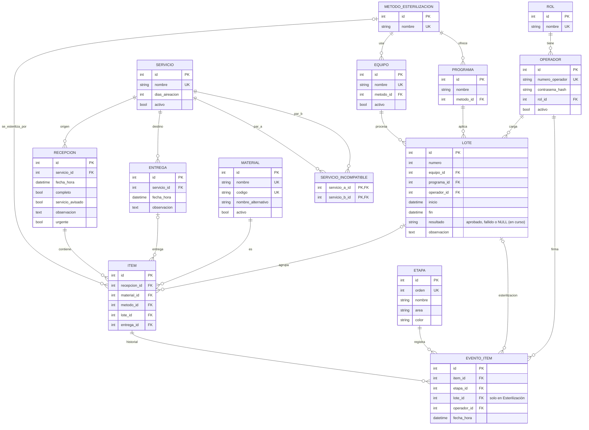

# Modelo entidad-relación de CICLO

Estado: coincide con las migraciones hasta la `0007`: esquema inicial (`9afab0f20aec`), `0002` (datos fijos), `0003` (ajuste de índices), `0004` a `0006` (datos de catálogos y `material.codigo`) y `0007` (reesterilización, recepción completa, aireación y urgencia).

El modelo tiene 14 tablas.

## Reglas que garantiza la base de datos

- `item`: si tiene `lote_id`, debe tener `metodo_id`. Si tiene `entrega_id`, debe tener `lote_id` (CHECK).
- `recepcion`: si `completo` es falso, `servicio_avisado` debe ser verdadero y `observacion` no puede estar vacía (CHECK).
- `lote`: `fin` es nulo o mayor o igual que `inicio`. `numero` está entre 1 y 999. `resultado` es nulo, `aprobado` o `fallido`. Si es `fallido`, `observacion` (el motivo) es obligatoria (CHECK).
- `lote.numero` no es único: la numeración se reinicia al llegar a 999 o a pedido del ingeniero. Tiene un índice común.
- `servicio`: `dias_aireacion` es mayor o igual que 0 (CHECK).
- `servicio_incompatible`: `servicio_a_id < servicio_b_id` (CHECK), para que un par no se cargue dos veces en orden inverso.
- `evento_item`: único por (`item_id`, `etapa_id`, `lote_id`) con `NULLS NOT DISTINCT`. Las etapas sin lote se registran una sola vez por ítem, y Esterilización una vez por lote, lo que permite la reesterilización. Historial de solo agregado.
- `programa`: único por (`metodo_id`, `nombre`). `material.codigo` es único y opcional.

## Datos que no se guardan (se deducen)

- Etapa actual de un ítem: el último evento de su historial.
- Método de un lote: el de su equipo.
- Fin de aireación de un ítem de óxido de etileno: `lote.fin` más `servicio.dias_aireacion` del servicio de origen.
- Vínculo entre un lote fallido y su reemplazo: un ítem con dos eventos de Esterilización, cada uno con su lote.

## Reglas validadas en el backend (con pruebas)

- El método del ítem coincide con el del equipo del lote, y el programa del lote pertenece a ese método.
- No se mezclan servicios incompatibles en un lote.
- No se saltean etapas.
- Esterilización → Esterilización solo se permite si el lote anterior del ítem quedó `fallido`.
- `item.lote_id` es el lote del último evento de Esterilización del ítem.
- Un ítem de un lote fallido no puede avanzar a Almacén ni a Entrega (a validar con el servicio).
- Un material con cantidad se carga como varios ítems (uno por unidad). Una entrega parcial entrega parte de esos ítems.
- El backend asigna el siguiente número de lote.
- `evento_item.lote_id` solo se completa en el evento de Esterilización, y siempre se completa en ese evento.
- `item.lote_id` y el `lote_id` del último evento de Esterilización se actualizan en la misma transacción.

## Pendientes de validación con el servicio

| Tema | Efecto posible en el modelo |
|---|---|
| Datos del ciclo (foto del ticket de cada equipo) | Nuevas columnas o tabla en `lote` |
| Tras un lote fallido: ¿el material vuelve a Empaque o entra directo a otra esterilización? | Aflojar la unicidad de `evento_item` también en Empaque |
| ¿Un lote falla siempre completo o solo algunos materiales? | `resultado` por ítem en lugar de por lote |
| Numeración de lotes por equipo o general | Endurecer la unicidad de `lote.numero` (por ejemplo, con una serie) |
| Guardia Pediátrica como servicio aparte | Dato en `servicio` (migración de datos) |
| Origen "Particular" | Dato en `servicio` (migración de datos) |
| Bowie-Dick, reclamos y sugerencias | Tablas nuevas, si entran en el alcance |
| Verificación del lavado (conforme o rechazado) y lavado de ortopedia | Dato nuevo en el evento de Lavado |
| Número de piezas de una caja | Campo en `material` o en `item` |
| Incompatibilidad NEO y UTI según el método | Ampliar `servicio_incompatible` |
| Omitir la etapa de almacén | Cambio en el circuito de `etapa` |
| Programas por método (provisorio) | Mantener o quitar `programa.metodo_id` |

## Datos a cargar en la migración 0008

Programas de Líquidos 121 °C (autoclave), estufa 180 °C durante 1 hora y óxido de etileno ciclo caliente 56 °C. Días de aireación 10 (Neonatología) y 7 (Pediatría). Servicios "Particular" y, si se confirma, Guardia Pediátrica.