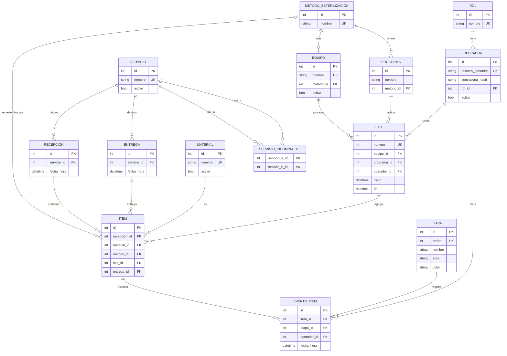

# Modelo entidad-relación de CICLO

Estado: coincide con las migraciones `9afab0f20aec` (esquema inicial) y `0002` (datos fijos).

Reglas que no se pueden dibujar en el diagrama:

- `item`: si tiene `lote_id`, debe tener `metodo_id`. Si tiene `entrega_id`, debe tener `lote_id` (restricciones CHECK).
- `lote`: `fin` es nulo o mayor o igual que `inicio` (CHECK).
- `servicio_incompatible`: `servicio_a_id < servicio_b_id` (CHECK), para que un par no se cargue dos veces en orden inverso.
- `evento_item`: único por (`item_id`, `etapa_id`). Historial de solo agregado.
- La etapa actual de un ítem no se guarda: se deduce de su último evento.
- El método de un lote se obtiene de su equipo.
- Reglas validadas en el backend: el método del ítem coincide con el del equipo del lote, no se mezclan servicios incompatibles en un lote y no se saltean etapas.
- Provisorios, pendientes de validar con el servicio: `programa.metodo_id` y la numeración de `lote.numero`.

## Reglas del backend (adicionales)

- El programa de un lote debe pertenecer al mismo método que el equipo del lote.

## Pendientes de validación con el servicio

| Tema | Efecto posible en el modelo |
|---|---|
| Numeración de lotes: reinicio por día, mes, año o equipo | Cambiar la unicidad de `lote.numero` |
| Reprocesamiento de un material | Agregar un número de intento a `evento_item` o reemplazar su restricción única |
| Datos del ciclo (temperatura, tiempo, resultado) | Nuevas columnas o tabla en `lote` |
| Urgencia de un material y quién la marca | Nueva columna en `item` |
| Materiales cargados por cantidad (por ejemplo, gasas) | Posible campo de cantidad en `item` |
| Observaciones en la entrega | Nueva columna en `entrega` |
| Programas propios de cada método | Mantener o quitar `programa.metodo_id` |