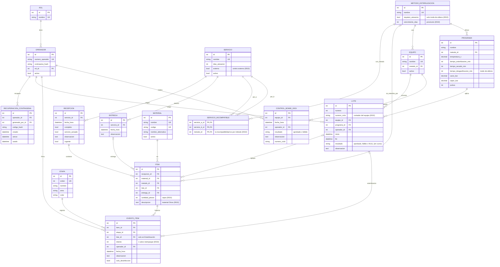

# Modelo entidad-relación de CICLO

Estado: coincide con las migraciones hasta la `0010`: esquema inicial (`9afab0f20aec`), `0002` (datos fijos), `0003` (ajuste de índices), `0004` a `0006` (datos de catálogos y `material.codigo`), `0007` (reesterilización, recepción completa, aireación y urgencia), `0008` (avance de lavado y empaque), `0009` (recuperación de contraseña) y `0010` (datos confirmados por el servicio).

Las respuestas del servicio que respaldan este modelo están en `docs/RESPUESTAS-SERVICIO.md`.

El modelo tiene 16 tablas.

## Reglas que garantiza la base de datos

- `item`: si tiene `lote_id`, debe tener `metodo_id`. Si tiene `entrega_id`, debe tener `lote_id`. `cantidad_piezas` es nula o mayor que 0 (CHECK).
- `recepcion`: si `completo` es falso, `servicio_avisado` debe ser verdadero y `observacion` no puede estar vacía (CHECK).
- `lote`: `fin` es nulo o mayor o igual que `inicio`. `numero` está entre 1 y 999. `resultado` es nulo, `aprobado` o `fallido`. Si es `fallido`, `observacion` (el motivo) es obligatoria (CHECK).
- `lote.numero` no es único: lo ingresa el operador en el equipo, se repite entre equipos y se reinicia. Si el lote falla, el número se da por usado. Tiene un índice común.
- `servicio`: `dias_aireacion` es mayor o igual que 0 (CHECK).
- `servicio_incompatible`: PK (`servicio_a_id`, `servicio_b_id`, `metodo_id`) y `servicio_a_id < servicio_b_id` (CHECK). Neonatología y UTI son incompatibles solo en óxido de etileno.
- `metodo_esterilizacion.vencimiento_dias` es nulo o mayor que 0 (CHECK).
- `programa`: único por (`metodo_id`, `nombre`); los tiempos y los pulsos no son negativos (CHECK). Todos los parámetros son opcionales (el programa P de la estufa no tiene valores fijos).
- `evento_item`: único por (`item_id`, `etapa_id`, `lote_id`, `intento`) con `NULLS NOT DISTINCT`; `intento` ≥ 1 (CHECK). Las etapas sin lote se registran una vez por ítem y por intento, y Esterilización una vez por lote, lo que permite la reesterilización con intento 1. El reempaque por falla del indicador interno usará intento 2. Si es solo desinfección, la observación es obligatoria (CHECK). Historial de solo agregado.
- `control_bowie_dick`: `resultado` es `aprobado` o `fallido`; si es `fallido`, `observacion` es obligatoria (CHECK).
- `material.codigo` es único y opcional.

## Datos que no se guardan (se deducen)

- Etapa actual de un ítem: el último evento de su historial.
- Método de un lote: el de su equipo.
- Fin de aireación de un ítem: `lote.fin` más `servicio.dias_aireacion` del servicio de origen, solo si el método tiene `requiere_aireacion`.
- Vínculo entre un lote fallido y su reemplazo: un ítem con dos eventos de Esterilización, cada uno con su lote. El lote falla siempre completo, así que sus ítems van a un mismo lote de reemplazo.
- Umbral de un lote sin cerrar (avisos): duración del programa (esterilización + secado + desgasificación) más un margen provisorio, nunca menos que el piso del método (`services/reglas_avisos.py`).

## Reglas validadas en el backend (con pruebas)

- El método del ítem coincide con el del equipo del lote, y el programa del lote pertenece a ese método.
- No se saltean etapas (`services/flujo.py`).
- Esterilización → Esterilización solo se permite si el lote anterior del ítem quedó `fallido`.
- `item.lote_id` es el lote del último evento de Esterilización del ítem.
- Un ítem de un lote fallido no puede avanzar a Almacén ni a Entrega.
- Un material con cantidad se carga como varios ítems (uno por unidad). Una entrega parcial entrega parte de esos ítems.
- El backend propone el siguiente número de lote del equipo.
- `evento_item.lote_id` solo se completa en el evento de Esterilización, y siempre se completa en ese evento.
- `item.lote_id` y el `lote_id` del último evento de Esterilización se actualizan en la misma transacción.

## Reglas preparadas para la API de esterilización (todavía no existe)

- **Servicios incompatibles según el método**: `services/compatibilidad.validar_servicios_compatibles(db, servicio_ids, metodo_id)`. La API tiene que llamarla al armar el lote.
- **Bowie-Dick (regla principal)**: no se puede esterilizar en el autoclave sin un control aprobado hoy. Consulta en `services/bowie_dick.hay_bowie_dick_aprobado_hoy(db, equipo_id, ahora)`: cuenta el último control del día local de Tucumán. La API tiene que llamarla antes de crear el lote.
- **Reproceso por falla del indicador interno** (pendiente): el material vuelve de Esterilización (lote fallido) a Empaque, con un intento nuevo (`services/reproceso.siguiente_intento`). La base ya lo admite, pero la transición todavía **no** está permitida en `services/flujo.py`: queda para la API de reproceso.

## Pendientes de validación con el servicio

| Tema | Efecto posible en el modelo |
|---|---|
| Renglones ilegibles del catálogo de materiales (hoja "Para confirmar") | Catálogo completo en la migración 0011 |
| Umbrales de los avisos de material detenido | Valores en `services/reglas_avisos.py` |
| Registrar la falla del indicador interno detectada en el servicio (mejora futura) | Evento o tabla nueva |
| A qué planilla corresponde "Pediatría" | Dato en `servicio` |
| Vencimiento del material estéril (hoy el más conservador: 90, 90 y 365 días) | Valor en `metodo_esterilizacion.vencimiento_dias` |
| Verificación del lavado (conforme o rechazado) | Dato nuevo en el evento de Lavado |
| Reclamos y sugerencias de la entrega | Campo o tabla nueva |
